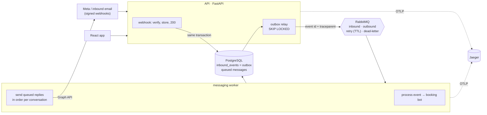

# SimpleCatch

A Hebrew/RTL SaaS for small businesses: website, leads, CRM, WhatsApp and an AI agent in one place.

## Architecture

A **modular monolith** (FastAPI, one PostgreSQL database, a module per feature) with one
**event-driven service** extracted where it pays off: a **messaging worker** that handles WhatsApp,
Messenger, Instagram and email traffic. Design and trade-offs:
[`docs/MESSAGING_SERVICE.md`](docs/MESSAGING_SERVICE.md) (decision D-202).



- **Transactional outbox.** A webhook stores the signed delivery and answers 200 in milliseconds.
  A relay publishes it to RabbitMQ, so nothing is lost if the broker or the worker is down
  (at-least-once delivery).
- **Idempotent consumers.** Duplicate deliveries collapse on a hash of the raw body, events are
  processed under a row lock, and message ids are unique.
- **Retries and dead-letter queues.** Failures back off 2/4/8/16 s through TTL queues, then
  dead-letter after 5 attempts. Provider refusals (4xx) fail at once.
- **Ordered sends.** Outgoing replies are queued and sent per conversation under an advisory lock,
  so the bot's text → list → photo never arrive out of order, even across retries.
- **Observability.** OpenTelemetry follows one message as a single trace across both services
  (context stored on the outbox row and carried in broker messages). The worker has its own
  `/health` with queue depths, backlog age and dead-letter counts.
- **Tenant isolation.** Every tenant-owned table has `business_id`, and every tenant route checks
  membership and permissions server-side (shared permission matrix).
- **One switch.** `MESSAGE_BUS=inline` runs the same code inside the request with no broker
  (tests, e2e, the single production service); `rabbitmq` uses the worker.

Stack: FastAPI · SQLAlchemy 2 · Alembic · PostgreSQL · RabbitMQ (aio-pika) · OpenTelemetry ·
React 18 · TypeScript · TanStack Query · Tailwind · Zod · pytest · Vitest · Playwright · Docker.

## Quick start

Requires Node 22+, pnpm 9, Python 3.12 with [uv](https://docs.astral.sh/uv/), Docker.

```bash
docker compose up -d
cp apps/api-py/.env.example apps/api-py/.env
pnpm install
(cd apps/api-py && uv sync)
pnpm db:migrate        # Alembic: builds or updates the schema
pnpm dev
```

- Web: http://localhost:5173
- API: http://localhost:4000/health, http://localhost:4000/health/db
- Mailpit (local email inbox): http://localhost:8025
- Postgres: `localhost:5432` (stop other local Postgres containers using that port first)
- Messaging worker (started by `pnpm dev`): http://localhost:4200/health
- RabbitMQ: http://localhost:15672 (guest/guest) · Jaeger traces: http://localhost:16686

## Checks

```bash
pnpm lint && pnpm typecheck && pnpm test && pnpm test:api && pnpm build
(cd apps/api-py && uv run ruff check . && uv run ruff format --check .)
pnpm exec playwright install chromium   # first time
pnpm e2e
```

## Repo layout

```
apps/api-py     FastAPI + SQLAlchemy + Alembic API (modular monolith; it replaced the Node API)
                  app/workers/   the messaging worker (python -m app.workers.messaging)
                  app/modules/inbound, outbound   outbox, relay, consumers, ordered sends
apps/web        React + Vite admin app (Hebrew RTL)
packages/shared Zod contracts, error codes, roles/permissions (the web app's source of types for now)
e2e/            Playwright tests
docs/           Architecture, decisions, roadmap, backlog, feature specs
```

See `CLAUDE.md` for development rules and `docs/FEATURE_BACKLOG.md` for status.
